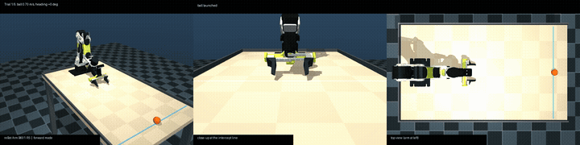

# reBot ball interception

A 6-DoF robot arm that blocks a ball rolled toward it down a table. A fixed camera tracks the ball,
the arm predicts where it will cross an intercept line, and moves its open gripper there so the ball
rolls into the jaw.

The project runs both in **MuJoCo simulation** and on the **real hardware**: a Seeed Studio
[reBot Arm B601-RS](https://github.com/Seeed-Projects/reBot-DevArm) (RobStride motors over CAN) and an
Intel RealSense D435i.

<p align="center">
  
  <br><sub>Simulation: overview, close-up at the intercept line, top view (<a href="docs/media/sim_demo_forward.mp4">mp4</a>)</sub>
</p>

## Status

| part | state |
|---|---|
| Simulation: scripted interception from ground truth | ✅ 100/100 balls caught |
| Simulation: vision in the loop (camera model + classic CV tracker) | ✅ 100/100, 2-3 mm error, robust to 30 fps / 100 ms latency |
| Real arm: CAN link, joint readout, model match | ✅ |
| Real arm: first powered motions (gripper, single joints) | ✅ |
| Real camera: 60 fps stream, marker-based calibration to the robot frame | ✅ |
| Real tracking in shadow mode (arm unpowered) | 🔧 ready, being tested |
| Gravity-compensated hold for joints 2-3, powered interception | ⏳ next |

## Repository layout

```
eaiproject/                     Python package
  ball_intercept_env.py         MuJoCo env, scripted InterceptPolicy, IK
  ball_tracker.py               camera calibration model + HSV/Kalman ball tracker
  tracked_intercept.py          sim camera model + tracker-driven policy
  real_intercept.py             real rig: calibration loading, tracker setup, real-time planner
  robstride.py                  RobStride CAN protocol over PEAK PCAN-USB (with a motor allow-list)
  realsense_client.py           client for the RealSense frame server
  kinematics.py, markers.py, calib_board.py   FK from joint readings, ArUco markers, ChArUco board
  sysid/                        actuator system identification (PACE): excitation, logging, CMA-ES fit
scripts/
  sysid/                        collect.py (real arm or --sim), fit.py -> sim_params.json, fake_can_test.py (README.md)
  sim/                          render_demo, eval_scripted, eval_tracked, live_tracking
  real/                         hardware: checks, motion tests, camera server, calibration, tracking
    legacy/                     older calibration method (ball touches)
assets/rebot_b601_rs/           arm model (MJCF/URDF/meshes) from Seeed + our scene XML
docs/
  simulation.md                 sim details, env API, results
  real_rig.md                   hardware setup, step-by-step bring-up, safety, troubleshooting
  charuco_board_A4.pdf          optional printable calibration board
```

## Quick start (simulation)

Python 3.12. The simulation needs no hardware.

```bash
git clone https://github.com/AbdullahSohail15/rebot-ball-intercept.git
cd rebot-ball-intercept
python3.12 -m venv .venv && .venv/bin/pip install -r requirements.txt

.venv/bin/python scripts/sim/eval_scripted.py --n 20               # scripted policy, random launches
.venv/bin/python scripts/sim/render_demo.py --mode forward         # -> outputs/demo_ball_intercept_forward.mp4
.venv/bin/python scripts/sim/live_tracking.py --window             # camera + tracker in the loop, live
```

On a headless Linux machine, prefix rendering commands with `MUJOCO_GL=egl`. More in
[docs/simulation.md](docs/simulation.md).

## Real rig

Bring-up goes from read-only checks to powered motion, one level of risk at a time. The full guide,
including the macOS-specific camera and CAN setup, is in [docs/real_rig.md](docs/real_rig.md).

```bash
# 1. read-only: is everything connected and does the arm match the model?
.venv/bin/python scripts/real/gripper_test.py                  # all joint states
.venv/bin/python scripts/real/joint_check.py --ranges          # move joints by hand, compare with the sim

# 2. first powered motions (one motor at a time, asks before moving)
.venv/bin/python scripts/real/gripper_test.py --move
.venv/bin/python scripts/real/arm_motion_test.py               # joint 1 +15 deg and back

# 3. camera (root frame server on macOS, then a live view)
scripts/real/start_camera.sh
.venv/bin/python scripts/real/camera_view.py

# 4. calibration: camera pose from ArUco markers + fingertip touches, then the table height
.venv/bin/python scripts/real/calibrate_markers.py
.venv/bin/python scripts/real/table_height.py

# 5. live tracking with the arm in shadow mode
.venv/bin/python scripts/real/real_tracking.py
```

Calibration results, logs and camera frames are written to `outputs/`, which is git-ignored.

### Safety

Every hardware script enables only the motors it moves; the CAN wrapper refuses commands to any other
motor. Powered scripts stop and disable on tracking error, stall, faults, lost feedback, unexpected
motion of other joints, Ctrl+C and exceptions. Joints 2 and 3 carry the arm's weight and drop when
disabled, so they are not moved until a gravity-compensated hold exists. Read
[docs/real_rig.md#safety-rules](docs/real_rig.md#safety-rules) before powering anything.

## How it works

1. **Tracking.** The ball is found by an HSV colour threshold inside the calibrated table area. Its
   centroid is projected onto the plane of the ball centre and filtered by a constant-velocity Kalman
   filter with real frame timestamps. No learned detector; about 1-2 ms per frame.
2. **Prediction.** A straight-line extrapolation gives where and when the ball crosses the intercept
   line (x = 0.40 m from the arm base).
3. **Planning.** The open jaw (fingertips 20 mm above the table, tilted 30° down, turned to face the
   ball) is moved along the line with rate limits. Damped least-squares IK in the MuJoCo model gives
   the joint targets.
4. **Calibration (real rig).** The camera pose comes from ArUco markers whose robot-frame positions are
   measured by touching them with the arm's fingertips. Heights are relative to a table plane measured
   the same way, which cancels the arm model's height bias.

## Contributing

- Branch from `main`, keep pull requests focused, and describe how you tested the change (sim run,
  hardware run, or both).
- Don't commit anything from `outputs/`: camera frames can show people in the lab.
- Hardware changes: run the read-only checks first, and never bypass the motor allow-list in
  `RobStrideBus`.

## Credits and licenses

- Code in this repository: [MIT](LICENSE).
- Arm model (MJCF, URDF, meshes): [Seeed-Projects/reBot-DevArm](https://github.com/Seeed-Projects/reBot-DevArm)
  and the RS digital-twin repositories listed in `assets/rebot_b601_rs/source.json`, under
  CERN-OHL-W-2.0 (`assets/rebot_b601_rs/LICENSE_reBot-DevArm`). Wrist-camera assets keep their own
  licences in `assets/rebot_b601_rs/mjcf/licenses/`.
- Motor protocol details follow Seeed's `reBotArm_control_py` and RobStride's documentation.
- PCAN on macOS: [PCBUSB library](https://www.mac-can.com) (separate download, non-commercial use).
